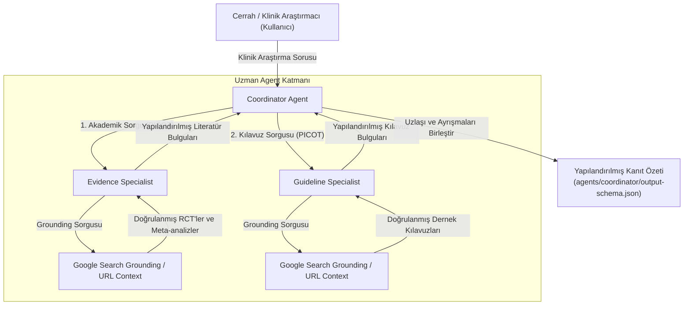

# Surgical AI Agents

> **Kanıta Dayalı Cerrahi Araştırmalar İçin Eğitsel Multi-Agent Mimarisi**

[](https://github.com/devenes/surgical-ai-agents/actions/workflows/ci.yml)
[](pyproject.toml)
[](LICENSE)
[](#mevcut-durum)
[](https://github.com/google/adk)

**[English](README.md) | [Türkçe](README-TR.md)**

**Surgical AI Agents**, agentik yapay zeka mimarilerinin yapılandırılmamış klinik araştırma ikilemlerini nasıl yapılandırılmış ve kanıta dayalı araştırma özetlerine (evidence briefs) dönüştürebileceğini gösteren eğitsel bir kavram kanıtı (POC) ve referans uygulamasıdır. Akademik cerrahlar, cerrahi asistanları, klinik fellow'lar ve sağlık bilişimi araştırmacıları için tasarlanan bu depo; akademik araştırmayı hastaya özgü klinik karar destek süreçlerinden kesin olarak ayırırken, multi-agent ayrıştırmasını, araç tabanlı web grounding mekanizmasını ve şemayla kısıtlanmış üretimi sergiler.

---

## 🔬 Bu Proje Neyi Göstermektedir?

Geleneksel monolitik ticari sohbet botları (chatbots), akademik cerrahi bağlamında sıklıkla şu problemlerle karşılaşır:
1. **Atıf Uydurma (Citation Hallucinations)**: Mantıklı gelen ancak tamamen kurgusal yazarlar, var olmayan PMID'ler veya uydurma randomize kontrollü çalışmalar (RCT).
2. **Yapılandırılmamış Anlatı Metni (Unstructured Narrative Prose)**: Metodolojik bir sınıflandırma yapmaksızın randomize çalışma sonuçlarını subjektif uzman görüşleriyle harmanlayan sohbet tarzı yanıtlar.
3. **Kanıtların Birbirine Karışması (Evidence Conflation)**: Hakemli dergilerdeki çalışma kanıtlarını resmi uzmanlık derneği klinik uygulama kılavuzlarından sistematik olarak ayıramama.
4. **Güvenli Olmayan Bireysel Öneriler**: Genel literatürü değerlendirmek yerine, bireyselleştirilmiş hasta ikilemlerine uygunsuz tavsiyeler verme cüreti.

Bu proje **agentik çözümü** sergilemektedir:
- **Görev Ayrıştırması (Task Decomposition - PICOT)**: Karmaşık cerrahi araştırma sorularını resmi epidemiyolojik bileşenlere ayırma (Population, Intervention, Comparator, Outcomes, Timeframe).
- **Uzman Alt Agent Delegasyonu (Specialist Subagent Delegation)**: Klinik çalışma literatür taramasını uzmanlık derneği kılavuz taramasından yapısal olarak ayırma.
- **Search Grounding ve İzlenebilirlik**: Her bulguyu doğrulanabilir başlıklar, yayın yılları ve yayıncı URL'leri ile gerçek zamanlı Google Search sorgularına dayandırma.
- **Epistemik Tevazu (Epistemic Humility)**: Uzlaşıyı, çelişkili bulguları, klinik belirsizlikleri ve kanıt bulunmadığında açık `not_found` durumlarını net bir şekilde belirtme.
- **Katı Şema Zorunluluğu (Strict Schema Enforcement)**: Nihai sentezi doğrulanmış bir JSON sözleşmesine (`output-schema.json`) bağlama.

---

## 🎓 Çalıştay Bağlamı ve İnteraktif Eğitim Adımları

Bu depo, **60 dakikalık etkileşimli bir çalıştay** için resmi uygulamalı teknik müfredat olarak hizmet eder:
- **Başlık**: *Multi-Agent AI Architectures in Surgical Research: From Clinical Inquiries to Structured Evidence*
- **Ana Fikir**: *"Cerrahi bir problemi bir AI iş akışına/projesine dönüştürmek için agentik yapay zekayı kullanın."*
- **Hedef Kitle**: Akademik cerrahlar, cerrahi asistanları ve sağlık bilişimi araştırmacıları.
- **Uygulamalı Yüzeyler**: [İnteraktif Web UI](app/README.md) (FastAPI + Streamlit), Google Cloud Agent Studio Canvas ve [Python ADK CLI](adk/README.md).

### ⏱️ Oturum Eğitim Adımları Yol Haritası (Session Tutorial Steps Roadmap)

60 dakikalık çalıştay boyunca bu adım adım eğitim akışını izleyin:

| Adım / Bölüm | Süre | Pedagojik Hedef | Uygulamalı Eylemler ve Komutlar | Birincil Alt Belge Bağlantıları (TR / EN) | Temel Çıktı |
| :---: | :---: | :--- | :--- | :--- | :--- |
| **Adım 0** | **T-30m** | **Kürsü Doğrulaması ve Kurulum** | Otomatik sıfır-token prova komutunu çalıştırın veya yerel Web Studio'yu başlatın | • [Kürsü Doğrulama Protokolü](workshop/presenter-runbook-TR.md#🛡️-t-30-dakika-çalıştay-öncesi-prova-protokolü-kürsü-doğrulaması---podium-verification) ([EN](workshop/presenter-runbook.md#🛡️-t-30-minute-pre-workshop-rehearsal-protocol-podium-verification))<br>• [Yerel Web UI Kılavuzu](docs/local-ui-setup-TR.md) ([EN](docs/local-ui-setup.md))<br>• [Google Cloud & ADC Kurulumu](docs/google-cloud-setup-TR.md) ([EN](docs/google-cloud-setup.md))<br>• [Windows Kurulum Kılavuzu](docs/windows-setup-guide-TR.md) ([EN](docs/windows-setup-guide.md)) | 16 önbelleğe alınmış vaka ile doğrulanmış yerel çalışma zamanı (`http://127.0.0.1:8501`) |
| **Adım 1** | **00–07m** (7dk) | **Cerrahın Üretken Yapay Zeka İkilemi** | Tek adımlı sohbet botu kusurlarını (halüsinasyon, kanıt hiyerarşisi eksikliği) multi-agent orkestrasyonu ile karşılaştırma | • [Çalıştay Görsel Taslağı](workshop/storyboard-TR.md) ([EN](workshop/storyboard.md))<br>• [Klinik Güvenlik ve CDSS Olmama Politikası](docs/safety-TR.md) ([EN](docs/safety.md))<br>• [Sistem Mimarisi ve Tasarım](docs/architecture-TR.md) ([EN](docs/architecture.md))<br>• [Sunucu Konuşma Notları](workshop/presenter-runbook-TR.md#bölüm-1-giriş-ve-agentic-değişim-0000--0700) ([EN](workshop/presenter-runbook.md#segment-1-introduction--the-agentic-shift-0000--0700)) | PICOT ayrıştırmasını ve klinik güvenlik bariyerlerini anlama |
| **Adım 2** | **07–20m** (13dk) | **Canlı Multi-Agent Demosu** | Birincil kolorektal prehab prompt'unu gönderin; Coordinator'ın PICOT ayrıştırmasını ve uzmanlara delegasyonunu izleyin | • [Canlı Demo Metni](workshop/presenter-runbook-TR.md#bölüm-2-canlı-multi-agent-demosu-0700--2000) ([EN](workshop/presenter-runbook.md#segment-2-live-multi-agent-demo-0700--2000))<br>• [Birincil Kolorektal Prehab Vakası](examples/research-questions/colorectal-prehabilitation.md)<br>• [Birincil Demo Prompt'u](workshop/demo-prompts-TR.md#1-birincil-demo-multimodal-kolorektal-prehabilitasyon-primary-demo) ([EN](workshop/demo-prompts.md#1-primary-demo-multimodal-colorectal-prehabilitation))<br>• [Agent Studio Kurulum Listesi](agents/agent-studio/setup-checklist.md)<br>• [Terminal ADK CLI Çalıştırıcısı](adk/run.py) | Doğrulanmış alıntılarla üretilen ilk kaynaklı kanıt özeti |
| **Adım 3** | **20–25m** (5dk) | **İz İncelemesi ve Grounding Denetimi** | Yürütme izi (Trace) çekmecesini açın; Google Search sorgularını, kaynak URL'lerini ve Draft-07 JSON şema sözleşmelerini denetleyin | • [İz İnceleme Kılavuzu](workshop/presenter-runbook-TR.md#bölüm-3-mimari-analiz-ve-trace-incelemesi-2000--2500) ([EN](workshop/presenter-runbook.md#segment-3-architectural-deconstruction--trace-inspection-2000--2500))<br>• [Coordinator Çıktı Sözleşmesi](agents/coordinator/output-schema.json)<br>• [Gemini 3.8 Flash Grounding Özellikleri](docs/model-baseline-TR.md) ([EN](docs/model-baseline.md))<br>• [Sınıf Sorun Giderme Kılavuzu](workshop/troubleshooting-TR.md) ([EN](workshop/troubleshooting.md)) | Araç çağrılarının ve şema doğrulama mekanizmalarının incelenmesi |
| **Adım 4** | **25–30m** (5dk) | **Tamamlayıcı Operatif Vision Demosu** | Strasberg Critical View of Safety (CVS) şemasını gözlemleyin; tanı koymayan anatomik gözlem için iki aşamalı prompt | • [Multimodal Demo Genel Bakış](multimodal-demo/README-TR.md) ([EN](multimodal-demo/README.md))<br>• [İki Aşamalı Vision Prompt'ları](multimodal-demo/prompt-TR.md) ([EN](multimodal-demo/prompt.md))<br>• [Tanı Koymayan Güvenlik Politikası](multimodal-demo/safety-TR.md) ([EN](multimodal-demo/safety.md))<br>• [Vision Sunucu Metni](multimodal-demo/presenter-script-TR.md) ([EN](multimodal-demo/presenter-script.md))<br>• [Sentetik CVS Şematik Çizimi](multimodal-demo/assets/laparoscopic_cvs_schematic.png) | Cerrahi görme-dil sınırlarını kavrama (Sıfır PHI) |
| **Adım 5** | **30–50m** (20dk) | **Uygulamalı Katılımcı Egzersizi** | Katılımcılar kendi klinik ikilemlerini 4 adımlı çalışma sayfasıyla ayrıştırır (Ham Soru → PICOT → Uzman Görevleri → Ana Prompt) | • [Katılımcı Çalışma Sayfası](workshop/participant-guide-TR.md) ([EN](workshop/participant-guide.md))<br>• [16 Kıyaslama Prompt'u](workshop/demo-prompts-TR.md) ([EN](workshop/demo-prompts.md))<br>• [İnteraktif Web Paneli](app/README.md)<br>• [4 Kademeli Çevrimdışı Acil Durum Planı](workshop/fallback-demo-TR.md) ([EN](workshop/fallback-demo.md)) | PICOT çerçevesiyle formüle edilmiş cerrahi araştırma AI projesi |
| **Adım 6** | **50–57m** (7dk) | **Grup Değerlendirmesi ve Epistemik Tevazu** | Uç durumları stres testine tabi tutun: Eksik çalışma kanıtı (`EDGE-01 HIFU`), çelişkili kılavuzlar (`EDGE-03 Bağırsak Hazırlığı`) ve hasta güvenliği tuzağı (`EDGE-07`) | • [16 Vakalı Kıyaslama Veri Seti](evaluations/test-cases.yaml)<br>• [Değerlendirme Kriterleri](evaluations/expected-behavior.md)<br>• [Klinik Tuzaklar ve Sınır Vakaları](prompts/edge-cases.md)<br>• [Moderatör Değerlendirme Kılavuzu](workshop/presenter-runbook-TR.md#bölüm-6-sonuçları-paylaşma-ve-çıktı-değerlendirmesi-5000--5700) ([EN](workshop/presenter-runbook.md#segment-6-group-discussion--output-appraisal-5000--5700)) | `not_found: true` durumlarının ve güvenlik retlerinin doğrulanması |
| **Adım 7** | **57–60m** (3dk) | **Kapanış, Kod Aynası ve Sonraki Adımlar** | Agent Studio'yu Python ADK koduna aktarın; PRISMA sistematik derleme hattını, kurumsal RAG yol haritasını ve Cloud Run dağıtımını inceleyin | • [ADK Kurulum ve Kod Aynası Kılavuzu](docs/adk-setup-TR.md) ([EN](docs/adk-setup.md))<br>• [Mimari ve Yol Haritası](docs/architecture-TR.md) ([EN](docs/architecture.md))<br>• [Cloud Run Dağıtım Kılavuzu](workshop/cloud-deployment-TR.md) ([EN](workshop/cloud-deployment.md))<br>• [Çalıştay Paketi Kataloğu](workshop/README-TR.md) ([EN](workshop/README.md)) | Prototipi yayına veya hibe başvurusuna dönüştürmek için somut yol haritası |

---

## 🏛️ Mimari (Architecture)

Birincil mimari hiyerarşik bir coordinator-specialist kalıbı uygular:



### Operasyonel Yüzeyler (Operational Surfaces)

Mimari karışıklığı önlemek için depo dört operasyonel yüzeyi birbirinden açıkça ayırır:

| Yüzey | Ortam | Modalite | Birincil Amaç |
| :--- | :--- | :--- | :--- |
| **İnteraktif Web UI** | Yerel Web (`app/` FastAPI + Streamlit) | Multimodal ve Multi-Agent | Görsel inceleme, 2 alt agent konsensüsü ve sorgu ayrıştırması içeren kullanıcı dostu panel. |
| **Agent Studio Uygulaması** | Google Cloud Agent Studio Canvas | Metin Tabanlı Multi-Agent | Etkileşimli görsel denetim için birincil uygulamalı çalıştay gösterimi. |
| **ADK Referans Uygulaması** | Python (`google-adk` + `google-genai`) | Metin Tabanlı Multi-Agent | Otomatik testler, değerlendirmeler ve CLI çalıştırmaları için programatik referans uygulaması. |
| **Tamamlayıcı Multimodal Demo** | Bağımsız Betik (`multimodal-demo/`) | Görme-Dil (Vision-Language) | Operatif anatomik gözlem için tamamlayıcı 5 dakikalık sergileme; araştırma tuvalinden tamamen izole. |

---

## ⚙️ ADK Referans Uygulaması

Programatik referans uygulaması [`adk/`](adk/) dizininde yer alır:
- **Framework**: Google Agent Development Kit (`google-adk>=2.11.0`) ve resmi Google GenAI SDK (`google-genai>=2.28.0`).
- **Temel Model**: Vertex AI üzerinde `gemini-3.8-flash` (multi-region `us` veya `global`).
- **Muhakeme Kontrolleri**: Gemini 3.8 `thinking_config(thinking_level="MEDIUM")` özelliğini kullanır.
- **Delegasyon Topolojisi**: Tek adımlı alt agent yürütmesi (`sub_agents=[evidence_agent, guideline_agent]`).
- **Tiplenmiş Sözleşmeler**: Draft-07 JSON şemalarıyla eşleşen Pydantic v2 veri modelleri ([`adk/schemas.py`](adk/schemas.py)).
- **CLI Çalıştırıcısı**: Zaman aşımı koruması ve şema doğrulaması ile terminal tabanlı yürütme için [`adk/run.py`](adk/run.py).

---

## 🖥️ Agent Studio Uygulaması

Görsel çalıştay uygulaması [`agents/agent-studio/`](agents/agent-studio/) dizininde yapılandırılmıştır:
- **Kök Coordinator Düğümü** (`surgical-evidence-coordinator`): Araç çakışmasını önlemek için doğrudan arama aracına sahip değildir; görevleri alt agent'lara devreder ve özeti sentezler.
- **Evidence Specialist Düğümü** (`evidence-specialist`): Biyotıp literatürü için Google Search Grounding ile donatılmış alt agent.
- **Guideline Specialist Düğümü** (`guideline-specialist`): Cerrahi uzmanlık derneği kılavuzları için Google Search Grounding ile donatılmış alt agent.
- **Yapılandırma Bildirimleri**: Eksiksiz prompt talimatları, kurulum kontrol listeleri ve bağlantı kılavuzları [`agents/agent-studio/setup-checklist.md`](agents/agent-studio/setup-checklist.md) içinde sağlanmıştır.

---

## 🔄 Kanıt / Kılavuz Araştırma İş Akışı

1. **PICOT Ayrıştırması**: Coordinator gelen sorguyu standartlaştırır:
   - **Population (Popülasyon)**: Belirli cerrahi hasta kohortu (örn. elektif kolorektal rezeksiyon geçiren yetişkinler).
   - **Context (Bağlam)**: Cerrahi ortam (elektif vs. acil).
   - **Intervention / Exposure (Girişim)**: Cerrahi teknik, protokol veya cihaz (örn. multimodal prehabilitasyon).
   - **Comparator (Karşılaştırıcı)**: Standart bakım / geleneksel tedavi.
   - **Outcomes (Sonuçlar)**: Birincil ve ikincil cerrahi sonlanım noktaları (örn. 30 günlük morbidite, fonksiyonel iyileşme, yatış süresi).
   - **Timeframe (Zaman Aralığı)**: Değerlendirilen yayın aralığı.
2. **Uzman Delegasyonu**:
   - **Evidence Specialist**: Klinik kanıt hiyerarşisi genelinde filtreleme yaparak akademik veritabanlarını (PubMed, Cochrane, majör cerrahi dergiler) sorgular (Sistematik Derlemeler/Meta-analizler > Çok Merkezli RCT'ler > Karşılaştırmalı Gözlemsel Çalışmalar).
   - **Guideline Specialist**: Tanınmış cerrahi kurumları (ASCRS, ERAS Society, SAGES, EAES, ESCP, NICE, WHO) klinik uygulama parametreleri açısından sorgular.
3. **Uzmanlar Arası Uzlaştırma (Cross-Specialist Reconciliation)**:
   - Çalışma sonuçlarını uzmanlık derneği öneri dereceleriyle karşılaştırır.
   - Doğrudan klinik uzlaşı alanlarını belirler.
   - Uluslararası kılavuz farklılıklarını veya çelişkili çalışma bulgularını vurgular.
   - Cerrahların incelemesi için tartışma soruları formüle eder.

---

## 🔗 Grounding ve Atıflar

Uzman agent'lar tarafından üretilen tüm iddialar canlı arama araçları aracılığıyla doğrulanır:
- **Atıf Uydurma Yoktur (No Hallucinated Citations)**: Bir çalışma veya kılavuz gerçek zamanlı arama ile doğrulanamazsa hariç tutulur.
- **İzlenebilir Meta Veriler**: Alıntılar kaynak başlığını, başyazarları veya yayımlayan kuruluşu, yayın yılını, belge türünü ve resmi URL adresini içerir.
- **Epistemik Tevazu (`not_found` Durumu)**: Güvenilir kanıtların bulunmadığı kanıtlanmamış veya çok yeni cerrahi teknikler değerlendirilirken, agent'lar spekülatif sonuçlar çıkarmak yerine `not_found: true` durumunu bildirir.

---

## 🖼️ Multimodal Demo (Tamamlayıcı)

Bağımsız bir gösterim [`multimodal-demo/`](multimodal-demo/) dizininde yer almaktadır:
- **Kapsam**: Görme-dil anlayışının tamamlayıcı 5 dakikalık eğitsel keşfi.
- **Mimari**: Birincil metin tabanlı Agent Designer tuvalinden kesin olarak ayrılmıştır.
- **Varlık**: Laparoskopik kolesistektomide Strasberg Critical View of Safety'nin sentetik, prosedürel anatomik şeması ([`multimodal-demo/assets/`](multimodal-demo/assets/)).
- **Uyumluluk**: **%100 Sıfır-PHI ve Sıfır Hasta Tanımlaması**. Hiçbir klinik tarama, fotoğraf veya kimliği belirlenebilir hasta verisi içermez.
- **İki Aşamalı Prompt**:
  1. *Aşama 1*: Anatomik işaretlerin ve laparoskopik aletlerin nötr görsel gözlemi.
  2. *Aşama 2*: Bilgisayarlı görü araştırma görevlerinin akademik bilişim tartışması (alet segmentasyonu, aşama tanıma, DECIDE-AI raporlaması).

---

## 🛡️ Güvenlik Sınırları

> [!CAUTION]
> **Katı Klinik Bariyerler ve Sorumluluk Reddi Beyanları**:
> - **Gerçek Hasta Verisi / PHI Kesinlikle Yasaktır**: Dosya numarası, hasta baş harfleri, ameliyat tarihleri veya tanımlayıcı klinik kayıtların girilmesi kesinlikle yasaktır.
> - **Hastaya Özgü Klinik Tavsiye Verilemez**: Sistem bireysel bir hasta için tanısal, tedavi edici, ameliyat zamanlaması veya ilaç dozu kararları veremez.
> - **Otomatik Güvenlik Reddi**: Hastaya özgü sorgular tespit edildiğinde (örn. *"72 yaşındaki hastamın ameliyatını ertelemeli miyim?"*), sistem bireysel tavsiyeyi reddeder ve genel araştırma sentezine yönlendirir.
> - **Tıbbi Cihaz veya CDSS Değildir**: Bu sistem bir çalıştay eğitsel prototipidir. Asla bir Klinik Karar Destek Sistemi (CDSS) veya tıbbi cihaz teşkil etmez.

*Tüm güvenlik dokümantasyonunu [`docs/safety-TR.md`](docs/safety-TR.md) ([EN](docs/safety.md)) dosyasından okuyabilirsiniz.*

---

## 📁 Depo Yapısı (Repository Structure)

```text
surgical-ai-agents/
├── README.md                          # Proje genel bakışı, mimari ve kılavuzlar (EN)
├── README-TR.md                       # Proje genel bakışı, mimari ve kılavuzlar (TR)
├── LICENSE                            # Apache-2.0 açık kaynak lisansı
├── pyproject.toml                     # Python paket meta verileri ve bağımlılıkları (PEP 621)
├── .env.example                       # Güvenli ortam şablonu (kimlik bilgisi içermez)
├── .gitignore                         # Gizli bilgi, işletim sistemi, sanal ortam ve önbellek hariç tutmaları
│
├── adk/                               # Programatik ADK referans uygulaması
│   ├── config.py                      # Vertex AI model başlatma ve ortam yapılandırması
│   ├── schemas.py                     # output-schema.json ile eşleşen Pydantic modelleri
│   ├── run.py                         # CLI çalıştırma aracı (python -m adk.run)
│   ├── eval.py                        # 6 boyutlu değerlendirme test çalıştırıcısı
│   ├── coordinator/agent.py           # Coordinator agent fabrikası ve alt agent bağlantıları
│   ├── evidence/agent.py              # Evidence specialist fabrikası ve search grounding
│   └── guideline/agent.py             # Guideline specialist fabrikası ve search grounding
│
├── agents/                            # Multi-agent prompt talimatları ve şemaları
│   ├── agent-studio/                  # Agent Studio talimatları, kontrol listeleri ve güvenlik politikası
│   ├── coordinator/                   # Coordinator talimatları ve output-schema.json
│   ├── evidence/                      # Evidence specialist talimatları ve output-schema.json
│   └── guideline/                     # Guideline specialist talimatları ve output-schema.json
│
├── workshop/                          # Eksiksiz 60 dakikalık çalıştay paketi
│   ├── README.md                      # Çalıştay paketi genel bakışı (EN)
│   ├── README-TR.md                   # Çalıştay paketi genel bakışı (TR)
│   ├── presenter-runbook.md           # Dakika dakika sunucu kılavuzu (EN)
│   ├── presenter-runbook-TR.md        # Dakika dakika sunucu kılavuzu (TR)
│   ├── participant-guide.md           # Katılımcı çalışma sayfası (EN)
│   ├── participant-guide-TR.md        # Katılımcı çalışma sayfası (TR)
│   ├── demo-prompts.md                # Kıyaslama prompt'ları ve dönüşüm örnekleri (EN)
│   ├── demo-prompts-TR.md             # Kıyaslama prompt'ları ve dönüşüm örnekleri (TR)
│   ├── storyboard.md                  # Kavramsal bilişsel yolculuk (EN)
│   ├── storyboard-TR.md               # Kavramsal bilişsel yolculuk (TR)
│   ├── troubleshooting.md             # Sınıf hata modları ve hızlı çözümler (EN)
│   ├── troubleshooting-TR.md          # Sınıf hata modları ve hızlı çözümler (TR)
│   ├── fallback-demo.md               # 4 kademeli acil durum planı (EN)
│   ├── fallback-demo-TR.md            # 4 kademeli acil durum planı (TR)
│   ├── cloud-deployment.md            # Cloud Run ve konteyner dağıtım kılavuzu (EN)
│   └── cloud-deployment-TR.md         # Cloud Run ve konteyner dağıtım kılavuzu (TR)
│
├── multimodal-demo/                   # Tamamlayıcı 5 dakikalık multimodal gösterim
│   ├── README.md                      # Multimodal paket sınır bildirimi (EN)
│   ├── README-TR.md                   # Multimodal paket sınır bildirimi (TR)
│   ├── adk_multimodal_example.py      # Bağımsız GenAI vision referans betiği
│   ├── prompt.md                      # İki aşamalı gözlem prompt'ları (EN)
│   ├── prompt-TR.md                   # İki aşamalı gözlem prompt'ları (TR)
│   ├── safety.md                      # Tanı koymayan multimodal güvenlik politikası (EN)
│   ├── safety-TR.md                   # Tanı koymayan multimodal güvenlik politikası (TR)
│   ├── presenter-script.md            # Sunucu konuşma metni ve akışı (EN)
│   ├── presenter-script-TR.md         # Sunucu konuşma metni ve akışı (TR)
│   ├── test-cases.md                  # Test senaryoları ve doğrulama durumları (EN)
│   ├── test-cases-TR.md               # Test senaryoları ve doğrulama durumları (TR)
│   ├── fallback.md                    # Önceden hesaplanmış gösterim yanıtları (EN)
│   ├── fallback-TR.md                 # Önceden hesaplanmış gösterim yanıtları (TR)
│   └── assets/                        # Sentetik, CC0/Apache-2.0 anatomik diyagramlar (Sıfır PHI)
│
├── docs/                              # Teknik dokümantasyon ve baseline bildirimleri
│   ├── architecture.md                # Ayrıntılı mimari ve yüzey sınırları (EN & TR)
│   ├── google-cloud-setup.md          # Google Cloud kurulum, IAM ve ADC talimatları (EN & TR)
│   ├── model-baseline.md              # Gemini 3.8 Flash baseline ve konum özellikleri (EN & TR)
│   ├── safety.md                      # Klinik güvenlik politikaları ve sorumluluk reddi (EN & TR)
│   ├── environment.md                 # Yerel geliştirme ortamı raporu (EN & TR)
│   └── agent-studio-setup.md          # Adım adım Agent Studio kurulum talimatları (EN & TR)
│
├── evaluations/                       # Değerlendirme çerçevesi ve kıyaslamalar
│   ├── evalset.json                   # 16 vakalık değerlendirme kıyaslama veri seti
│   ├── test-cases.yaml                # Çalıştırılabilir test senaryoları (8 normal, 8 uç durum)
│   └── results/                       # Kaydedilmiş değerlendirme kıyaslama çalışmaları
│
├── examples/                          # Referans çıktılar ve doğrulanmış kanıt özetleri
│   └── research-questions/
│       ├── colorectal-prehabilitation.md
│       ├── colorectal-prehabilitation-gemini-3-8.json
│       └── colorectal-prehabilitation-live-example.json
│
├── tests/                             # Birim ve entegrasyon test paketleri
│   ├── test_unit_schemas.py           # JSON şemaları ve Pydantic modelleri için çevrimdışı testler
│   ├── test_unit_agents.py            # Agent inşası ve bağlantıları için çevrimdışı testler
│   └── test_integration_live.py       # Canlı entegrasyon testleri (Vertex AI ADC gerektirir)
│
├── backup/                            # Tarihsel keşif prototipleri ve taslak arşivleri
│   └── README.md                      # Arşivlenmiş deneysel iş akışları kataloğu
│
└── app/                               # Hafif Web UI (FastAPI + Streamlit)
    ├── README.md                      # Web UI mimarisi ve bileşen dokümantasyonu
    ├── cli.py                         # Birleşik başlatıcı (python -m app.cli)
    ├── backend/                       # FastAPI REST arka ucu (/docs Swagger OpenAPI)
    │   ├── api.py                     # API rotaları (/api/health, /api/models, /api/multimodal, vb.)
    │   ├── schemas.py                 # Pydantic doğrulama sözleşmeleri
    │   └── service.py                 # GenAI SDK ve sıfır-token simülasyonunu koordine eden AppService
    └── frontend/                      # Streamlit etkileşimli uygulaması
        ├── main.py                    # Çok sekmeli panel (Vision, Multi-Agent, PICOT)
        └── components.py              # Görsel zaman çizelgesi, konsensüs matrisi ve kontroller
```

---

## 🖥️ İnteraktif Web UI (FastAPI + Streamlit)

[`app/`](app/) dizininde hafif ve etkileşimli bir web uygulaması mevcuttur:
- **Multimodal Vision Studio**: Tanısal olmayan anatomik gözlem için görsel yükleyin veya cerrahi şemaları seçin (örn. Critical View of Safety).
- **2-Subagent Consensus Studio**: Görsel adım zaman çizelgeleri ve yan yana bulgularla Evidence Specialist (Sub-Agent 1) ve Guideline Specialist (Sub-Agent 2) agent'larını orkestre eden Coordinator.
- **Sıfır-Token Çevrimdışı Modu**: Kullanıcı arayüzünü **0 token tüketerek** test etmek ve keşfetmek için yüksek doğruluklu simülasyon modu.

### Kullanıcı Arayüzünü Yerel Olarak Başlatma

```bash
# Seçenek 1: Hem FastAPI hem Streamlit'i eşzamanlı başlatma (Önerilen)
uv run python -m app.cli all

# Seçenek 2: Yalnızca FastAPI arka ucunu başlatma (http://127.0.0.1:8000/docs)
uv run python -m app.cli backend --backend-port 8000

# Seçenek 3: Yalnızca Streamlit ön yüzünü başlatma (http://127.0.0.1:8501)
uv run python -m app.cli frontend --frontend-port 8501
```

*Kapsamlı kurulum ayrıntıları ve sorun giderme için [Yerel UI Kurulum Kılavuzu](docs/local-ui-setup-TR.md) ([EN](docs/local-ui-setup.md)) ve [Windows Kurulum Kılavuzu](docs/windows-setup-guide-TR.md) ([EN](docs/windows-setup-guide.md)) belgelerine bakın.*

---

## 🚀 Hızlı Başlangıç (Quick Start)

> 🪟 **Windows Kullanıcıları**: Adım adım PowerShell/CMD kurulumu, etkinleştirme betikleri ve sorun giderme için özel [Windows Kurulum Kılavuzu](docs/windows-setup-guide-TR.md) ([EN](docs/windows-setup-guide.md)) dokümanını inceleyin.

### Ön Koşullar
- Python 3.10+ (Python 3.12 ile test edilmiştir)
- Vertex AI API etkinleştirilmiş Google Cloud Projesi (canlı mod için; çevrimdışı simülasyon modu için gerekmez)
- Google Cloud Application Default Credentials (`gcloud auth application-default login`)

### Kurulum

```bash
# 1. Depoyu klonlayın
git clone https://github.com/devenes/surgical-ai-agents.git
cd surgical-ai-agents

# 2. uv veya venv kullanarak sanal ortam oluşturun
uv venv --python 3.12

# 3. Sanal ortamı etkinleştirin
# macOS / Linux üzerinde:
source .venv/bin/activate
# Windows üzerinde (PowerShell):
# .venv\Scripts\Activate.ps1

# 4. Bağımlılıkları yükleyin
uv pip install -e ".[dev]"
```

---

## 🔧 Konfigürasyon

1. Ortam yapılandırma şablonunu kopyalayın:
   ```bash
   cp .env.example .env
   ```

2. Google Cloud yapılandırmanızı girmek için `.env` dosyasını düzenleyin:
   ```bash
   GOOGLE_CLOUD_PROJECT=your-gcp-project-id
   GOOGLE_CLOUD_LOCATION=us
   GEMINI_MODEL=gemini-3.8-flash
   ```

3. Google Cloud Application Default Credentials (ADC) ile kimlik doğrulaması yapın:
   ```bash
   gcloud auth application-default login
   ```
   *Gizli API anahtarları veya service-account JSON dosyaları gerekmez.*

---

## 💻 Yerel Geliştirme (Local Development)

### ADK CLI Aracılığıyla Bir Sorgu Yürütme

```bash
# Varsayılan birincil araştırma sorusu ile çalıştırma (Kolorektal Prehabilitasyon)
.venv/bin/python -m adk.run

# Özel bir cerrahi araştırma sorusu ile çalıştırma
.venv/bin/python -m adk.run "What clinical trial evidence exists regarding ICG fluorescence for anastomotic leak prevention?"

# Yapılandırılmış JSON özetini diske kaydetme
.venv/bin/python -m adk.run --output brief.json

# Hastaya özgü güvenlik sınırı reddini test etme
.venv/bin/python -m adk.run "My 72-year-old patient has an albumin of 2.8. Should I delay resection for 3 weeks?"
```

---

## 🧪 Test

Depo çevrimdışı birim testleri ve canlı entegrasyon testleri içerir:

### 1. Çevrimdışı Birim Testleri (Güvenli, Sıfır Token Tüketilir)
```bash
# Tüm çevrimdışı test paketini çalıştırır (agent'lar, şemalar, API, servisler genelinde 61 birim test)
uv run pytest

# Yalnızca Web UI birim testlerini çalıştırma
uv run pytest tests/test_unit_app_*.py -v
```

### 2. Canlı Entegrasyon Testleri (Aktif Vertex AI Kimlik Bilgileri Gerektirir)
```bash
# Not: Model çıkarımı ve arama grounding tüketir
uv run pytest -m integration tests/test_integration_live.py
```

---

## 📚 Çalıştay Materyalleri (Workshop Materials)

Tüm çalıştay sunum, kolaylaştırma ve sorun giderme belgeleri [`workshop/`](workshop/) dizininde düzenlenmiştir:
- **[`presenter-runbook-TR.md`](workshop/presenter-runbook-TR.md)** ([EN](workshop/presenter-runbook.md)): Dakika dakika oturum akışı, konuşma noktaları ve tıklama talimatları (00–60dk).
- **[`participant-guide-TR.md`](workshop/participant-guide-TR.md)** ([EN](workshop/participant-guide.md)): PICOT ayrıştırması ve güvenlik sınırları için katılımcı çalışma sayfası.
- **[`demo-prompts-TR.md`](workshop/demo-prompts-TR.md)** ([EN](workshop/demo-prompts.md)): 8 normal vaka, 8 uç vaka ve prompt dönüşüm örnekleri.
- **[`troubleshooting-TR.md`](workshop/troubleshooting-TR.md)** ([EN](workshop/troubleshooting.md)): Sınıf içi bağlantı, gecikme veya şema sorunları için hızlı çözümler.
- **[`fallback-demo-TR.md`](workshop/fallback-demo-TR.md)** ([EN](workshop/fallback-demo.md)): 4 kademeli acil durum planı (önbelleğe alınmış kanıt özetleri, terminal çalıştırıcısı, tek agent fallback).
- **[`cloud-deployment-TR.md`](workshop/cloud-deployment-TR.md)** ([EN](workshop/cloud-deployment.md)): En az yetkili IAM yapılandırması ile Cloud Run konteyner dağıtım kılavuzu.
- **[`storyboard-TR.md`](workshop/storyboard-TR.md)** ([EN](workshop/storyboard.md)): Klinik ikilemden yapılandırılmış yapay zeka agent'ına uzanan kavramsal bilişsel yolculuk.

---

## 📊 Mevcut Durum (Current Status)

- **Durum**: **Çalıştay Prototipi ve Referans Uygulaması (Workshop Prototype & Reference Implementation)**
- **Web UI**: Multimodal ve 2 alt agent yeteneklerine sahip etkileşimli FastAPI + Streamlit arayüzü.
- **ADK Çekirdeği**: Tek adımlı alt agent delegasyonu ve Pydantic şemaları ile tamamen yapılandırılmış.
- **Grounding**: Resmi ADK araçları aracılığıyla Google Search Grounding'e bağlı.
- **Şemalar**: JSON Schema Draft-07 sözleşmelerine göre doğrulanmış.
- **Birim Testleri**: 61 çevrimdışı birim testi doğrulanmış ve geçmektedir (0 token tüketilir).
- **Güvenlik**: Hastaya özgü sorgularda otomatik güvenlik reddi tetiklenir.

---

## ⚠️ Bilinen Kısıtlamalar

1. **Çalıştay POC Kapsamı**: Eğitsel bir prototip olarak tasarlanmıştır; otonom bir tanı sistemi veya klinik karar motoru olarak tasarlanmamıştır.
2. **Search Grounding Gecikmesi**: Gerçek zamanlı çoklu agent web taraması, harici dergi portallarının yanıt sürelerine bağlı olarak 30–60 saniye sürebilir.
3. **Ücretli Literatür**: Web grounding açık erişimli özetleri, çalışma kayıtlarını ve kılavuz portallarını inceler; ücretli makalelerin tam metin çıkarımı yayıncı erişimine bağlıdır.
4. **Agent Studio UI Varyasyonları**: Google Cloud Agent Studio'daki konsol arayüzü düzenleri ve model seçicileri bölgelere ve güncellemelere göre değişiklik gösterebilir.

---

## 🗺️ Yol Haritası (Roadmap)

- [ ] **Phase 4A - Kurumsal RAG**: Özel hastane klinik yolları ve yerel antibiyogramlar için Vertex AI Search entegrasyonu.
- [x] **Phase 4B - İnteraktif Çalıştay UI**: [`app/`](app/) dizininde hafif web çalıştırıcısı (FastAPI + Streamlit).
- [x] **Phase 4C - Cloud Run Dağıtımı**: [`workshop/cloud-deployment-TR.md`](workshop/cloud-deployment-TR.md) ([EN](workshop/cloud-deployment.md)) içinde konteyner dağıtım kılavuzu ve üretim Dockerfile.

---

## 📄 Lisans

Bu proje **Apache License 2.0** kapsamında lisanslanmıştır - ayrıntılar için [LICENSE](LICENSE) dosyasına bakın.
