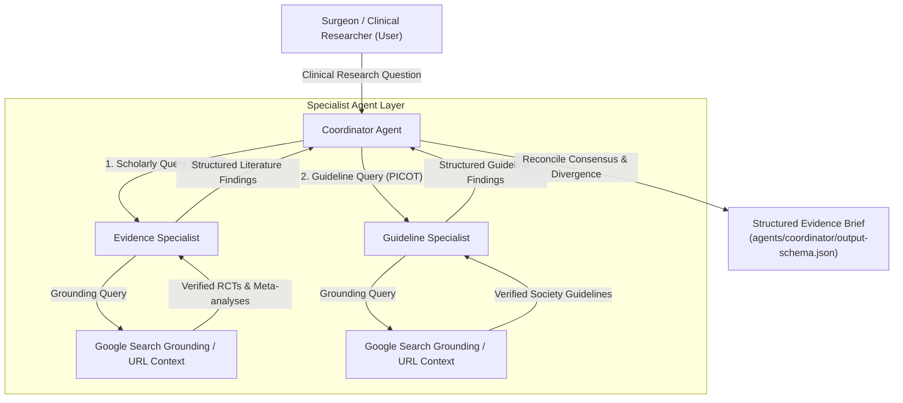

# Surgical AI Agents

> **An Educational Multi-Agent Architecture for Evidence-Based Surgical Research**

[](https://github.com/devenes/surgical-ai-agents/actions/workflows/ci.yml)
[](pyproject.toml)
[](LICENSE)
[](#current-status)
[](https://github.com/google/adk)

**[English](README.md) | [Türkçe](README-TR.md)**

**Surgical AI Agents** is an educational proof-of-concept (POC) and reference implementation demonstrating how agentic AI architectures can turn unstructured clinical research dilemmas into structured, evidence-grounded research briefs. Designed for academic surgeons, surgical residents, clinical fellows, and health informatics researchers, this repository illustrates multi-agent decomposition, tool-based web grounding, and schema-constrained generation while strictly separating academic research from patient-specific clinical decision support.

---

## 🔬 What This Project Demonstrates

Monolithic commercial chatbots frequently struggle in academic surgical contexts with:
1. **Citation Hallucinations**: Plausible-sounding but fictitious authors, non-existent PMIDs, or invented randomized controlled trials.
2. **Unstructured Narrative Prose**: Conversational answers that intermingle randomized trial results with subjective expert opinion without methodological classification.
3. **Evidence Conflation**: Inability to systematically distinguish peer-reviewed trial evidence from formal professional society clinical practice guidelines.
4. **Unsafe Individual Recommendations**: Inappropriate attempts to answer individualized, patient-specific dilemmas rather than evaluating generalized literature.

This project demonstrates the **agentic solution**:
- **Task Decomposition (PICOT)**: Deconstructing complex surgical questions into formal epidemiological components (Population, Intervention, Comparator, Outcomes, Timeframe).
- **Specialist Subagent Delegation**: Segregating clinical trial literature retrieval from formal clinical practice guideline retrieval.
- **Search Grounding & Traceability**: Anchoring every finding in real-time Google Search queries with verifiable titles, years, and publisher URLs.
- **Epistemic Humility**: Formalizing consensus, conflicting findings, clinical uncertainties, and explicit `not_found` states when evidence is absent.
- **Strict Schema Enforcement**: Constraining final synthesis to a validated JSON contract (`output-schema.json`).

---

## 🎓 Workshop Context & Interactive Tutorial Steps

This repository serves as the official hands-on technical curriculum for a **60-minute interactive workshop**:
- **Title**: *Multi-Agent AI Architectures in Surgical Research: From Clinical Inquiries to Structured Evidence*
- **Central Concept**: *"Use agentic AI to turn a surgical problem into an AI workflow/project."*
- **Target Audience**: Academic surgeons, surgical trainees, and health informatics researchers.
- **Hands-On Surfaces**: [Interactive Web UI](app/README.md) (FastAPI + Streamlit), Google Cloud Agent Studio Canvas, and [Python ADK CLI](adk/README.md).

### ⏱️ Session Tutorial Steps Roadmap

Follow this step-by-step tutorial sequence during the 60-minute workshop:

| Step / Segment | Time | Pedagogical Objective | Hands-On Actions & Commands | Primary Sub-Document Links (EN / TR) | Key Deliverable |
| :---: | :---: | :--- | :--- | :--- | :--- |
| **Step 0** | **T-30m** | **Podium Verification & Setup** | Run automated zero-token rehearsal command or launch local Web Studio | • [Presenter Rehearsal Protocol](workshop/presenter-runbook.md#🛡️-t-30-minute-pre-workshop-rehearsal-protocol-podium-verification) ([TR](workshop/presenter-runbook-TR.md#🛡️-t-30-dakika-çalıştay-öncesi-prova-protokolü-kürsü-doğrulaması---podium-verification))<br>• [Local Web UI Guide](docs/local-ui-setup.md) ([TR](docs/local-ui-setup-TR.md))<br>• [Google Cloud & ADC Setup](docs/google-cloud-setup.md) ([TR](docs/google-cloud-setup-TR.md))<br>• [Windows Setup Guide](docs/windows-setup-guide.md) ([TR](docs/windows-setup-guide-TR.md)) | Verified local runtime with 16 cached cases (`http://127.0.0.1:8501`) |
| **Step 1** | **00–07m** (7m) | **The Surgeon's Dilemma with GenAI** | Contrast single-turn chatbot flaws (hallucinations, lack of evidence hierarchy) with multi-agent orchestration | • [Workshop Storyboard & Cognitive Journey](workshop/storyboard.md) ([TR](workshop/storyboard-TR.md))<br>• [Clinical Safety & Non-CDSS Policy](docs/safety.md) ([TR](docs/safety-TR.md))<br>• [System Architecture & Design](docs/architecture.md) ([TR](docs/architecture-TR.md))<br>• [Presenter Talking Points](workshop/presenter-runbook.md#segment-1-introduction--the-agentic-shift-0000--0700) ([TR](workshop/presenter-runbook-TR.md#bölüm-1-giriş-ve-agentic-değişim-0000--0700)) | Understanding PICOT decomposition and clinical guardrails |
| **Step 2** | **07–20m** (13m) | **Live Multi-Agent Demonstration** | Submit primary colorectal prehab prompt; observe Coordinator decomposing PICOT and delegating to Evidence & Guideline specialists | • [Live Demo Script](workshop/presenter-runbook.md#segment-2-live-multi-agent-demo-0700--2000) ([TR](workshop/presenter-runbook-TR.md#bölüm-2-canlı-multi-agent-demosu-0700--2000))<br>• [Primary Colorectal Prehab Case](examples/research-questions/colorectal-prehabilitation.md)<br>• [Primary Demo Prompt](workshop/demo-prompts.md#1-primary-demo-multimodal-colorectal-prehabilitation) ([TR](workshop/demo-prompts-TR.md#1-birincil-demo-multimodal-kolorektal-prehabilitasyon-primary-demo))<br>• [Agent Studio Wiring Checklist](agents/agent-studio/setup-checklist.md)<br>• [Terminal ADK CLI Runner](adk/run.py) | First grounded evidence brief generated with verified citations |
| **Step 3** | **20–25m** (5m) | **Trace Inspection & Grounding Audit** | Inspect execution trace drawer; audit Google Search queries, verified source URLs, and Draft-07 JSON schema contracts | • [Trace Walkthrough Guide](workshop/presenter-runbook.md#segment-3-architectural-deconstruction--trace-inspection-2000--2500) ([TR](workshop/presenter-runbook-TR.md#bölüm-3-mimari-analiz-ve-trace-incelemesi-2000--2500))<br>• [Coordinator Output Contract](agents/coordinator/output-schema.json)<br>• [Gemini 3.8 Flash Grounding Specs](docs/model-baseline.md) ([TR](docs/model-baseline-TR.md))<br>• [Classroom Troubleshooting Guide](workshop/troubleshooting.md) ([TR](workshop/troubleshooting-TR.md)) | Inspection of tool calls and schema validation mechanisms |
| **Step 4** | **25–30m** (5m) | **Supplemental Operative Vision Demo** | Observe Strasberg Critical View of Safety (CVS) schematic; two-stage prompt for non-diagnostic anatomical observation | • [Multimodal Demo Overview](multimodal-demo/README.md) ([TR](multimodal-demo/README-TR.md))<br>• [Two-Stage Vision Prompts](multimodal-demo/prompt.md) ([TR](multimodal-demo/prompt-TR.md))<br>• [Non-Diagnostic Safety Policy](multimodal-demo/safety.md) ([TR](multimodal-demo/safety-TR.md))<br>• [Vision Presenter Script](multimodal-demo/presenter-script.md) ([TR](multimodal-demo/presenter-script-TR.md))<br>• [Synthetic CVS Schematic Diagram](multimodal-demo/assets/laparoscopic_cvs_schematic.png) | Understanding surgical vision-language boundaries (Zero PHI) |
| **Step 5** | **30–50m** (20m) | **Hands-On Participant Exercise** | Attendees deconstruct their own clinical dilemma using 4-step worksheet (Raw Question → PICOT → Specialist Tasks → Master Prompt) | • [Attendee Exercise Worksheet](workshop/participant-guide.md) ([TR](workshop/participant-guide-TR.md))<br>• [16 Curated Benchmark Prompts](workshop/demo-prompts.md) ([TR](workshop/demo-prompts-TR.md))<br>• [Interactive Web Dashboard](app/README.md)<br>• [4-Tier Offline Contingencies](workshop/fallback-demo.md) ([TR](workshop/fallback-demo-TR.md)) | Formulated surgical research AI project with PICOT framing |
| **Step 6** | **50–57m** (7m) | **Group Appraisal & Epistemic Humility** | Stress-test edge cases: Missing trial evidence (`EDGE-01 HIFU`), conflicting guidelines (`EDGE-03 Bowel Prep`), and patient safety trap (`EDGE-07`) | • [16-Case Benchmark Dataset](evaluations/test-cases.yaml)<br>• [Evaluation Rubric & Criteria](evaluations/expected-behavior.md)<br>• [Clinical Traps & Boundary Cases](prompts/edge-cases.md)<br>• [Facilitator Appraisal Guide](workshop/presenter-runbook.md#segment-6-group-discussion--output-appraisal-5000--5700) ([TR](workshop/presenter-runbook-TR.md#bölüm-6-sonuçları-paylaşma-ve-çıktı-değerlendirmesi-5000--5700)) | Verification of `not_found: true` states and safety refusals |
| **Step 7** | **57–60m** (3m) | **Wrap-Up, Code Mirror & Next Steps** | Export Agent Studio to Python ADK code; review PRISMA systematic review pipeline, institutional RAG roadmap, and Cloud Run hosting | • [ADK Setup & Code Mirror Guide](docs/adk-setup.md) ([TR](docs/adk-setup-TR.md))<br>• [Architecture & Evolution Roadmap](docs/architecture.md) ([TR](docs/architecture-TR.md))<br>• [Cloud Run Deployment Guide](workshop/cloud-deployment.md) ([TR](workshop/cloud-deployment-TR.md))<br>• [Workshop Package Catalog](workshop/README.md) ([TR](workshop/README-TR.md)) | Actionable pathway to turn prototype into publication or grant |

---

## 🏛️ Architecture

The primary architecture implements a hierarchical coordinator-specialist pattern:



### Operational Surfaces

To prevent architectural conflation, the repository clearly distinguishes three operational surfaces:

| Surface | Environment | Modality | Primary Purpose |
| :--- | :--- | :--- | :--- |
| **Interactive Web UI** | Local Web (`app/` FastAPI + Streamlit) | Multimodal & Multi-Agent | User-friendly interactive dashboard with tabs for vision inspection, 2-subagent consensus, and query decomposition. |
| **Agent Studio Implementation** | Google Cloud Agent Studio Canvas | Text-based Multi-Agent | Primary hands-on workshop demonstration for interactive visual inspection. |
| **ADK Reference Implementation** | Python (`google-adk` + `google-genai`) | Text-based Multi-Agent | Programmatic reference implementation for automated testing, evaluation, and CLI runs. |
| **Supplemental Multimodal Demo** | Standalone Script (`multimodal-demo/`) | Vision-Language | Supplemental 5-minute showcase of operative anatomical observation; strictly isolated from research canvas. |

---

## ⚙️ ADK Reference Implementation

The programmatic reference implementation is located in [`adk/`](adk/):
- **Framework**: Google Agent Development Kit (`google-adk>=2.11.0`) and official Google GenAI SDK (`google-genai>=2.28.0`).
- **Foundation Model**: `gemini-3.8-flash` on Vertex AI (multi-region `us` or `global`).
- **Reasoning Controls**: Utilizes Gemini 3.8 `thinking_config(thinking_level="MEDIUM")`.
- **Delegation Topology**: Single-turn subagent execution (`sub_agents=[evidence_agent, guideline_agent]`).
- **Typed Contracts**: Pydantic v2 data models in [`adk/schemas.py`](adk/schemas.py) matching Draft-07 JSON schemas.
- **CLI Runner**: [`adk/run.py`](adk/run.py) for terminal-based execution with timeout protection and schema validation.

---

## 🖥️ Agent Studio Implementation

The visual workshop implementation is configured in [`agents/agent-studio/`](agents/agent-studio/):
- **Root Coordinator Node** (`surgical-evidence-coordinator`): Holds no direct search tools to prevent tool collision; delegates to subagents and synthesizes the brief.
- **Evidence Specialist Node** (`evidence-specialist`): Child subagent equipped with Google Search Grounding for biomedical literature.
- **Guideline Specialist Node** (`guideline-specialist`): Child subagent equipped with Google Search Grounding for surgical society guidelines.
- **Configuration Manifests**: Complete prompt instructions, setup checklists, and wiring guides are provided in [`agents/agent-studio/setup-checklist.md`](agents/agent-studio/setup-checklist.md).

---

## 🔄 Evidence / Guideline Research Workflow

1. **PICOT Decomposition**: The Coordinator normalizes the inquiry:
   - **Population**: Specific surgical patient cohort (e.g. adults undergoing elective colorectal resection).
   - **Context**: Surgical setting (elective vs. emergency).
   - **Intervention / Exposure**: Surgical technique, protocol, or device (e.g. multimodal prehabilitation).
   - **Comparator**: Conventional standard of care.
   - **Outcomes**: Primary and secondary surgical endpoints (e.g. 30-day morbidity, functional recovery, length of stay).
   - **Timeframe**: Publication window evaluated.
2. **Specialist Delegation**:
   - **Evidence Specialist**: Queries academic databases (PubMed, Cochrane, major surgical journals), filtering across the clinical evidence hierarchy (Systematic Reviews/Meta-analyses > Multicenter RCTs > Comparative Observational Studies).
   - **Guideline Specialist**: Queries recognized surgical bodies (ASCRS, ERAS Society, SAGES, EAES, ESCP, NICE, WHO) for clinical practice parameters.
3. **Cross-Specialist Reconciliation**:
   - Compares trial outcomes against society recommendation grades.
   - Identifies areas of direct clinical agreement.
   - Highlights international guideline divergence or equivocal trial findings.
   - Formulates explicit discussion questions for surgical review.

---

## 🔗 Grounding & Citations

All assertions generated by the specialist agents are grounded via live search tools:
- **No Hallucinated Citations**: If a trial or guideline cannot be confirmed via real-time search, it is omitted.
- **Traceable Metadata**: Citations capture source title, lead authors or issuing organization, publication year, document type, and official URL.
- **Epistemic Humility (`not_found` State)**: When evaluating unproven or novel surgical techniques where reliable evidence is absent, agents set `not_found: true` rather than extrapolating speculative conclusions.

---

## 🖼️ Multimodal Demo (Supplemental)

A standalone demonstration is located in [`multimodal-demo/`](multimodal-demo/):
- **Scope**: Supplemental 5-minute educational exploration of vision-language understanding.
- **Architecture**: Strictly separated from the primary text-based Agent Designer canvas.
- **Asset**: Synthetic, procedural anatomical schematic of the Strasberg Critical View of Safety in laparoscopic cholecystectomy ([`multimodal-demo/assets/`](multimodal-demo/assets/)).
- **Compliance**: **100% Zero-PHI and Zero Patient Identification**. Contains no clinical scans, photographs, or identifiable patient data.
- **Two-Stage Prompt**:
  1. *Stage 1*: Neutral visual observation of anatomical landmarks and laparoscopic instruments.
  2. *Stage 2*: Academic informatics discussion of computer vision research tasks (e.g., tool segmentation, phase recognition, DECIDE-AI reporting).

---

## 🛡️ Safety Boundaries

> [!CAUTION]
> **Strict Clinical Guardrails & Disclaimers**:
> - **No Real Patient Data / PHI**: Entering medical record numbers, patient initials, surgical dates, or identifiable patient records is strictly prohibited.
> - **No Patient-Specific Clinical Advice**: The system must never make diagnostic, treatment, operative timing, or drug-dosing decisions for an individual patient.
> - **Automatic Safety Refusal**: When patient-specific queries are detected (e.g. *"Should I delay surgery for my 72yo patient?"*), the system refuses individualized advice and redirects to general research synthesis.
> - **Not a Medical Device or CDSS**: This system is a workshop educational prototype and literature synthesis tool. It does NOT constitute a Clinical Decision Support System (CDSS) or medical device.

*Read the complete safety documentation in [`docs/safety.md`](docs/safety.md).*

---

## 📁 Repository Structure

```text
surgical-ai-agents/
├── README.md                          # Project overview, architecture, and guides
├── LICENSE                            # Apache-2.0 open-source license
├── pyproject.toml                     # Python package metadata & dependencies (PEP 621)
├── .env.example                       # Safe environment template (no credentials)
├── .gitignore                         # Secret, OS, virtual environment, and cache exclusions
│
├── adk/                               # Programmatic ADK reference implementation
│   ├── config.py                      # Vertex AI model initialization & environment config
│   ├── schemas.py                     # Pydantic models matching output-schema.json
│   ├── run.py                         # CLI execution runner (python -m adk.run)
│   ├── eval.py                        # 6-dimension evaluation test runner
│   ├── coordinator/agent.py           # Coordinator agent factory & subagent wiring
│   ├── evidence/agent.py              # Evidence specialist factory & search grounding
│   └── guideline/agent.py             # Guideline specialist factory & search grounding
│
├── agents/                            # Multi-agent prompt instructions & schemas
│   ├── agent-studio/                  # Agent Studio instructions, checklists & safety policy
│   ├── coordinator/                   # Coordinator instructions & output-schema.json
│   ├── evidence/                      # Evidence specialist instructions & output-schema.json
│   └── guideline/                     # Guideline specialist instructions & output-schema.json
│
├── workshop/                          # Complete 60-minute workshop package
│   ├── README.md                      # Workshop package overview
│   ├── presenter-runbook.md           # Scripted minute-by-minute presenter guide (00–60m)
│   ├── participant-guide.md           # Attendee worksheet (PICOT framing, safety rules)
│   ├── demo-prompts.md                # Curated benchmark prompts & prompt transformations
│   ├── storyboard.md                  # Conceptual cognitive journey
│   ├── troubleshooting.md             # Common classroom failure modes & rapid fixes
│   └── fallback-demo.md               # 4-tier contingency plan (A: single agent, B: cached, C: ADK, D: canvas)
│
├── multimodal-demo/                   # Supplemental 5-minute multimodal demonstration
│   ├── README.md                      # Multimodal package boundary notice
│   ├── adk_multimodal_example.py      # Standalone GenAI vision reference script
│   ├── prompt.md                      # Standardized two-stage observation prompts
│   ├── safety.md                      # Non-diagnostic multimodal safety policy
│   ├── presenter-script.md            # Presenter talking points and sequence
│   └── assets/                        # Synthetic, CC0/Apache-2.0 anatomical diagrams (Zero PHI)
│
├── docs/                              # Technical documentation & baseline manifests
│   ├── architecture.md                # Detailed architecture and surface boundaries
│   ├── google-cloud-setup.md          # Google Cloud setup, IAM, and ADC instructions
│   ├── model-baseline.md              # Gemini 3.8 Flash baseline & location specifications
│   ├── safety.md                      # Detailed clinical safety policies and disclaimers
│   ├── environment.md                 # Local development environment report
│   └── agent-studio-setup.md          # Step-by-step Agent Studio setup instructions
│
├── evaluations/                       # Evaluation framework & benchmarks
│   ├── evalset.json                   # 16-case evaluation benchmark dataset
│   ├── test-cases.yaml                # Executable evaluation test cases (8 normal, 8 edge)
│   └── results/                       # Recorded evaluation benchmark runs
│
├── examples/                          # Reference outputs & verified evidence briefs
│   └── research-questions/
│       ├── colorectal-prehabilitation.md
│       ├── colorectal-prehabilitation-gemini-3-8.json
│       └── colorectal-prehabilitation-live-example.json
│
├── tests/                             # Unit and integration test suites
│   ├── test_unit_schemas.py           # Offline unit tests for JSON schemas & Pydantic models
│   ├── test_unit_agents.py            # Offline unit tests for agent construction & wiring
│   └── test_integration_live.py       # Live integration tests (requires active Vertex AI ADC)
│
├── backup/                            # Historical exploratory prototypes & draft archives
│   └── README.md                      # Catalog of archived experimental workflows
│
└── app/                               # Lightweight Web UI (FastAPI + Streamlit)
    ├── README.md                      # Web UI architecture and component documentation
    ├── cli.py                         # Unified launcher (python -m app.cli)
    ├── backend/                       # FastAPI REST backend (/docs Swagger OpenAPI)
    │   ├── api.py                     # API routes (/api/health, /api/models, /api/multimodal, etc.)
    │   ├── schemas.py                 # Pydantic validation contracts
    │   └── service.py                 # AppService coordinating GenAI SDK & zero-token mock
    └── frontend/                      # Streamlit interactive application
        ├── main.py                    # Multi-tab dashboard (Vision, Multi-Agent, PICOT)
        └── components.py              # Visual timeline, consensus matrix, and controls
```

---

## 🖥️ Interactive Web UI (FastAPI + Streamlit)

A lightweight interactive web application is available in [`app/`](app/):
- **Multimodal Vision Studio**: Upload images or select surgical schematics (e.g. Critical View of Safety) for non-diagnostic anatomical observation.
- **2-Subagent Consensus Studio**: Coordinator orchestrating Evidence Specialist (Sub-Agent 1) and Guideline Specialist (Sub-Agent 2) with visual step timelines and side-by-side findings.
- **Zero-Token Offline Mode**: High-fidelity simulation mode to test and explore the UI with **0 tokens consumed**.

### Launching the UI Locally

```bash
# Option 1: Launch both FastAPI and Streamlit concurrently (Recommended)
uv run python -m app.cli all

# Option 2: Launch FastAPI backend only (http://127.0.0.1:8000/docs)
uv run python -m app.cli backend --backend-port 8000

# Option 3: Launch Streamlit frontend only (http://127.0.0.1:8501)
uv run python -m app.cli frontend --frontend-port 8501
```

*For comprehensive setup details and troubleshooting, see the [Local UI Setup Guide](docs/local-ui-setup.md) and [Windows Setup Guide](docs/windows-setup-guide.md).*

---

## 🚀 Quick Start

> 🪟 **Windows Users**: Check the dedicated [Windows Setup & Execution Guide](docs/windows-setup-guide.md) for step-by-step PowerShell/CMD setup, activation scripts, and troubleshooting.

### Prerequisites
- Python 3.10+ (tested on Python 3.12)
- Google Cloud Project with Vertex AI API enabled (for live mode; not needed for offline mode)
- Google Cloud Application Default Credentials (`gcloud auth application-default login`)

### Installation

```bash
# 1. Clone repository
git clone https://github.com/devenes/surgical-ai-agents.git
cd surgical-ai-agents

# 2. Create virtual environment using uv or venv
uv venv --python 3.12

# 3. Activate virtual environment
# On macOS / Linux:
source .venv/bin/activate
# On Windows (PowerShell):
# .venv\Scripts\Activate.ps1

# 4. Install dependencies
uv pip install -e ".[dev]"
```

---

## 🔧 Configuration

1. Copy the environment configuration template:
   ```bash
   cp .env.example .env
   ```

2. Edit `.env` to supply your Google Cloud configuration:
   ```bash
   GOOGLE_CLOUD_PROJECT=your-gcp-project-id
   GOOGLE_CLOUD_LOCATION=us
   GEMINI_MODEL=gemini-3.8-flash
   ```

3. Authenticate with Google Cloud Application Default Credentials (ADC):
   ```bash
   gcloud auth application-default login
   ```
   *No secret API keys or service-account JSON files are required.*

---

## 💻 Local Development

### Executing an Inquiry via ADK CLI

```bash
# Run with default primary research question (Colorectal Prehabilitation)
.venv/bin/python -m adk.run

# Run with a custom surgical research question
.venv/bin/python -m adk.run "What clinical trial evidence exists regarding ICG fluorescence for anastomotic leak prevention?"

# Save structured JSON brief to disk
.venv/bin/python -m adk.run --output brief.json

# Test patient-specific safety boundary refusal
.venv/bin/python -m adk.run "My 72-year-old patient has an albumin of 2.8. Should I delay resection for 3 weeks?"
```

---

## 🧪 Testing

The repository contains offline unit tests and live integration tests:

### 1. Offline Unit Tests (Safe, No Tokens Consumed)
```bash
# Runs full offline suite (61 unit tests across agents, schemas, API routes, services, and rehearsal)
uv run pytest

# Run only Web UI unit tests
uv run pytest tests/test_unit_app_*.py -v
```

### 2. Live Integration Tests (Requires Active Vertex AI Credentials)
```bash
# Note: Consumes model inference and search grounding
uv run pytest -m integration tests/test_integration_live.py
```

---

## 📚 Workshop Materials

All workshop presentation, facilitation, and troubleshooting documents are organized in [`workshop/`](workshop/):
- **[`presenter-runbook.md`](workshop/presenter-runbook.md)** ([TR](workshop/presenter-runbook-TR.md)): Minute-by-minute session flow, talking points, and click instructions (00–60m).
- **[`participant-guide.md`](workshop/participant-guide.md)** ([TR](workshop/participant-guide-TR.md)): Attendee worksheet for PICOT decomposition and safety boundaries.
- **[`demo-prompts.md`](workshop/demo-prompts.md)** ([TR](workshop/demo-prompts-TR.md)): 8 normal cases, 8 edge cases, and prompt transformation examples.
- **[`troubleshooting.md`](workshop/troubleshooting.md)** ([TR](workshop/troubleshooting-TR.md)): Rapid solutions for classroom connectivity, latency, or schema issues.
- **[`fallback-demo.md`](workshop/fallback-demo.md)** ([TR](workshop/fallback-demo-TR.md)): 4-tier contingencies (cached evidence briefs, terminal runner, single-agent fallback).
- **[`cloud-deployment.md`](workshop/cloud-deployment.md)** ([TR](workshop/cloud-deployment-TR.md)): Cloud Run container deployment guide with least-privilege IAM configuration.
- **[`storyboard.md`](workshop/storyboard.md)** ([TR](workshop/storyboard-TR.md)): Conceptual cognitive journey from clinical dilemma to structured AI agent.

---

## 📊 Current Status

- **Status**: **Workshop Prototype & Reference Implementation**
- **Web UI**: Interactive FastAPI + Streamlit interface with multimodal and 2-subagent capabilities.
- **ADK Core**: Fully wired with single-turn subagent delegation and Pydantic schemas.
- **Grounding**: Connected to Google Search Grounding via official ADK tools.
- **Schemas**: Validated against JSON Schema Draft-07 contracts.
- **Unit Testing**: 61 offline unit tests verified and passing (0 tokens consumed).
- **Safety**: Automated safety refusal triggers on patient-specific inquiries.

---

## ⚠️ Known Limitations

1. **Workshop POC Scope**: Designed as an educational prototype; not intended as an autonomous diagnostic system or clinical decision engine.
2. **Search Grounding Latency**: Real-time multi-agent web retrieval can take 30–60 seconds depending on external journal portal response times.
3. **Paywalled Literature**: Web grounding inspects open-access abstracts, trial registries, and guideline portals; full-text extraction of paywalled articles depends on publisher access.
4. **Agent Studio UI Variation**: Console interface layouts and model pickers in Google Cloud Agent Studio may vary across regions and updates.

---

## 🗺️ Roadmap

- [ ] **Phase 4A - Institutional RAG**: Integration with Vertex AI Search for private hospital clinical pathways and local antibiograms.
- [x] **Phase 4B - Interactive Workshop UI**: Lightweight web runner (FastAPI + Streamlit) in [`app/`](app/).
- [x] **Phase 4C - Cloud Run Deployment**: Containerized deployment guide and production Dockerfile in [`workshop/cloud-deployment.md`](workshop/cloud-deployment.md).

---

## 📄 License

This project is licensed under the **Apache License 2.0** - see the [LICENSE](LICENSE) file for details.
