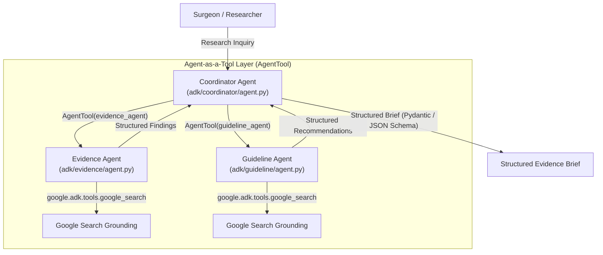

# Agent Development Kit (ADK) Implementation

## Overview & Status: WORKING POC (Phase 2)

This package contains the concrete, code-based implementation of the multi-agent surgical research architecture using the official **Google Agent Development Kit (`google-adk 2.11.0`)** and **Google GenAI SDK (`google-genai 2.28.0`)**.

---

## Architecture & Delegation Pattern



---

## Directory Structure

```
adk/
├── README.md               # This document
├── __init__.py             # Package root
├── config.py               # Model and GCP configuration factory
├── schemas.py              # Pydantic schema models matching output-schema.json
├── run.py                  # CLI entry point (python -m adk.run)
├── coordinator/            # Coordinator Agent implementation
│   ├── __init__.py
│   └── agent.py            # PICOT normalization, subagent delegation, and synthesis
├── evidence/               # Evidence Agent implementation
│   ├── __init__.py
│   └── agent.py            # Grounded literature search via google_search tool
└── guideline/              # Guideline Agent implementation
    ├── __init__.py
    └── agent.py            # Grounded clinical guidelines search via google_search tool
```

---

## Running the Multi-Agent POC Locally

### 1. Default Inquiry (Primary Colorectal Prehabilitation Demo)
```bash
# Run with default primary research question
.venv/bin/python -m adk.run
```

### 2. Custom Research Question
```bash
.venv/bin/python -m adk.run "In patients undergoing pancreaticoduodenectomy, what do RCTs report regarding minimally invasive vs open approaches?"
```

### 3. Save Output to File
```bash
.venv/bin/python -m adk.run --output brief.json
```

### 4. Patient-Specific Safety Boundary Test
```bash
.venv/bin/python -m adk.run "What should be done for this 72-year-old patient with colorectal cancer?"
```

---

## Verified Behavioral Capabilities

1. **Strict Delegation**: The Coordinator does not perform searches directly. It calls the Evidence and Guideline agents as tools via `AgentTool`.
2. **Grounding**: Both specialist agents issue real Google Search queries and extract verified citations and DOIs.
3. **Structured Validation**: Output is validated against `agents/coordinator/output-schema.json`.
4. **Safety Refusal**: Patient-specific questions trigger an immediate conversational refusal and educational redirection.
