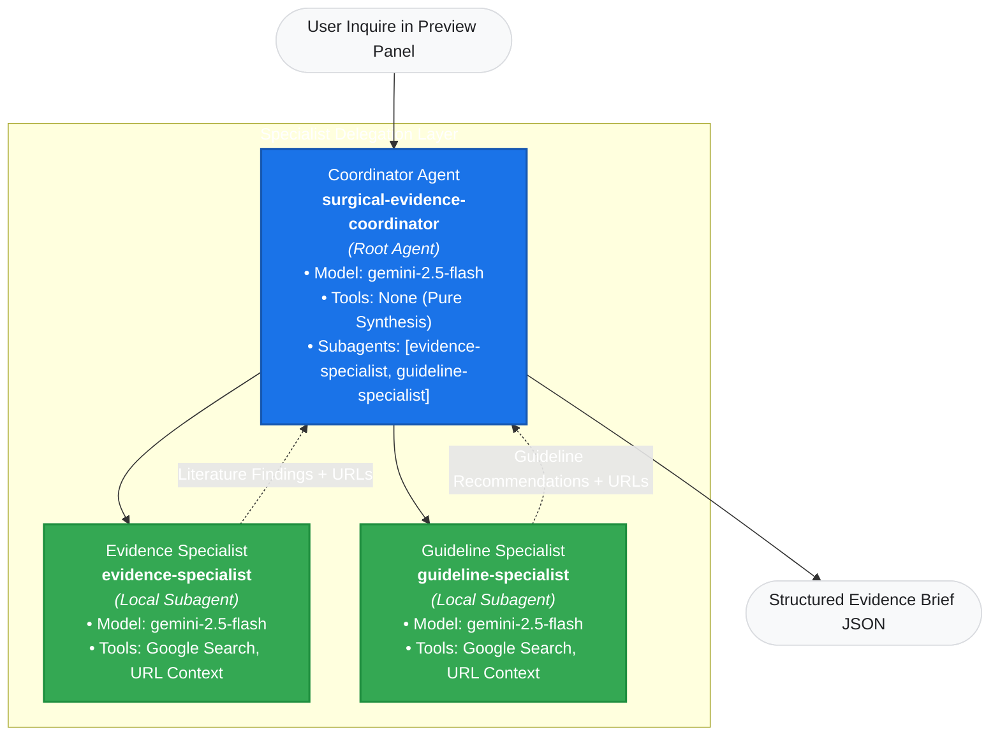

# Agent Studio Visual Workflow Specification

- **Target Interface**: Google Cloud Gemini Enterprise Agent Platform — Agent Studio Canvas
- **Design Pattern**: Root Orchestrator with Local Specialist Subagents
- **Primary Goal**: Low-code visual mirror of the verified ADK multi-agent architecture.

---

## 1. Visual Canvas Hierarchy & Graph Layout

---

## 2. Node Specifications

### Node 1: Coordinator Agent (Root Orchestrator)

| Attribute | Specification |
| :--- | :--- |
| **Node Type** | Root Agent (Primary Canvas Node) |
| **Agent Name** | `surgical-evidence-coordinator` |
| **Display Name** | `Surgical Evidence Coordinator` |
| **Description** | `Chief orchestrator and synthesizer for educational surgical research inquiries. Decomposes research topics via PICOT, delegates to specialist subagents (Evidence & Guideline), and produces structured evidence briefs.` |
| **Model** | `gemini-3.8-flash` |
| **Reasoning / Thinking Level** | `MEDIUM` (sampling parameters like temperature are deprecated in Gemini 3.8 Flash) |
| **Instructions Source** | [coordinator-instructions.md](coordinator-instructions.md) |
| **Subagents** | 1. `evidence-specialist` 2. `guideline-specialist` |
| **Tools** | **None** (Do NOT attach Google Search or code interpreters directly to the Coordinator node). |
| **Output Format** | JSON Structured Evidence Brief adhering to [output-schema.json](../coordinator/output-schema.json). |

---

### Node 2: Evidence Specialist (Local Subagent)

| Attribute | Specification |
| :--- | :--- |
| **Node Type** | Local Subagent (Child of Coordinator) |
| **Agent Name** | `evidence-specialist` |
| **Display Name** | `Evidence Research Agent` |
| **Description** | `Specialist agent for retrieving, evaluating, and summarizing peer-reviewed surgical literature, randomized controlled trials (RCTs), and systematic reviews using search grounding.` |
| **Model** | `gemini-3.8-flash` |
| **Reasoning / Thinking Level** | `MEDIUM` (sampling parameters like temperature are deprecated in Gemini 3.8 Flash) |
| **Instructions Source** | [evidence-instructions.md](evidence-instructions.md) |
| **Tools** | 1. **Google Search** (Grounding with Google Search tool enabled) 2. **URL Context** (Web URL scraper/reader; enabled as optional context) |
| **Output Contract** | Structured list of study findings with titles, years, tiers (RCT, systematic review), verified URLs, key findings, and limitations. |

---

### Node 3: Guideline Specialist (Local Subagent)

| Attribute | Specification |
| :--- | :--- |
| **Node Type** | Local Subagent (Child of Coordinator) |
| **Agent Name** | `guideline-specialist` |
| **Display Name** | `Guideline Specialist Agent` |
| **Description** | `Specialist agent for retrieving, evaluating, and cataloging official clinical practice guidelines, consensus statements, and practice parameters from recognized national and international surgical societies.` |
| **Model** | `gemini-3.8-flash` |
| **Reasoning / Thinking Level** | `MEDIUM` (sampling parameters like temperature are deprecated in Gemini 3.8 Flash) |
| **Instructions Source** | [guideline-instructions.md](guideline-instructions.md) |
| **Tools** | 1. **Google Search** (Grounding with Google Search tool enabled) 2. **URL Context** (Web URL scraper/reader; enabled as optional context) |
| **Output Contract** | Structured list of guideline statements with issuing organization, formal title, publication year, recommendation summary, grade, verified URL, and divergence notes. |

---

## 3. Tool Allocation Rationales

1. **Why No Search Tool on Coordinator?**:
   - In ADK and Vertex AI, assigning both search tools and complex schema synthesis tools to the same agent node causes function-calling collisions and `INVALID_ARGUMENT` errors.
   - Separating search into specialist subagents enforces architectural modularity: specialist agents retrieve and cite, while the Coordinator aggregates and synthesizes.
2. **Why Both Google Search and URL Context on Specialists?**:
   - Google Search performs fast discovery of indexed clinical publications and society guideline repositories.
   - URL Context provides optional deep inspection of specific web pages where full abstracts or recommendation grades are nested within publisher pages.
