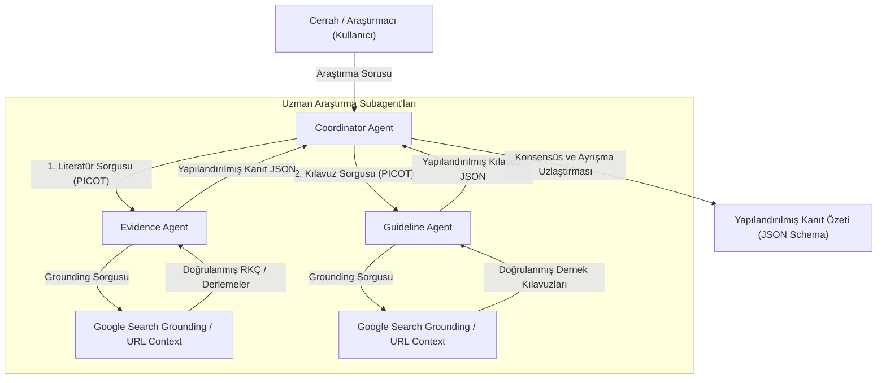
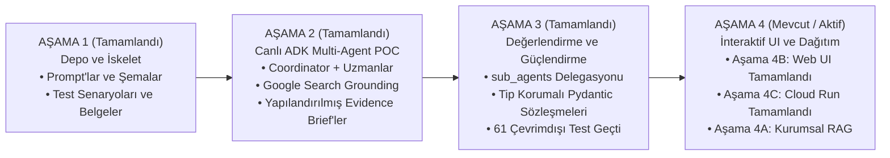

# Mimari ve Sistem Tasarımı

## Genel Bakış

**Surgical AI Agents** sistemi, kanıta dayalı cerrahi araştırmalar için multi-agent orkestrasyonunu göstermek üzere tasarlanmıştır. Mimari; görev ayrıştırma (task decomposition), uzmanlaşmış subagent'lar, gerçek zamanlı web grounding ve schema kısıtlamalı üretim aracılığıyla karmaşık klinik araştırma sorularını yapılandırılmış ve doğrulanmış kanıt özetlerine (evidence briefs) dönüştürür.

---

## Ürün Sınırları ve Operasyonel Yüzeyler

Sistem, mimari karmaşayı önlemek için dört operasyonel yüzeyi kesin olarak birbirinden ayırır:

1. **İNTERAKTİF WEB UI**:
   - **Ortam**: Yerel Web (`app/` FastAPI + Streamlit)
   - **Modalite**: Multimodal Vision & Multi-Agent Consensus Studio
   - **Topoloji**: Operatif Vision Studio, 2-Subagent Consensus Studio, PICOT Query Decomposer, Specialist Deep-Dive ve Sıfır-Token Çevrimdışı Simülasyon Modu sekmelerini içeren tam donanımlı interaktif kontrol paneli.
   - **Rolü**: Katılımcılar ve kolaylaştırıcılar için birincil uygulamalı interaktif arayüz; 16 klinik benchmark senaryosunun tamamında hem canlı Vertex AI hem de 0-token çevrimdışı simülasyonu destekler.

2. **BİRİNCİL WORKSHOP SİSTEMİ (AGENT STUDIO)**:
   - **Ortam**: Google Cloud Agent Studio (Agent Designer Canvas)
   - **Modalite**: %100 Metin Tabanlı Multi-Agent Araştırma İş Akışı
   - **Topoloji**: Root Coordinator + 2 Yerel Subagent (`evidence-specialist`, `guideline-specialist`)
   - **Rolü**: İnteraktif tuval incelemesi, subagent yönlendirmesi ve canlı preview izleri (traces) için görsel workshop demonstrasyon platformu.

3. **TAMAMLAYICI VISION MİNİ-DEMOSU**:
   - **Ortam**: Bağımsız Komut Dosyası (`multimodal-demo/`) veya Agent Studio Chat / Freeform
   - **Modalite**: Multimodal Vision-Language Anlama (`gemini-3.8-flash`)
   - **Rolü**: Operatif anatomik işaret gözlemini (Critical View of Safety) ve cerrahi bilgisayarlı görü araştırma görevlerini gösteren 5 dakikalık tamamlayıcı vitrin.
   - **Sınırı**: Metin tabanlı araştırma tuvalinden kesin olarak ayrı tutulur; sıfır hasta tanımlaması (%100 sentetik vektör şemaları).

4. **GELİŞTİRİCİ REFERANS UYGULAMASI**:
   - **Ortam**: Google Agent Development Kit (ADK `2.11.0` / `google-genai 2.28.0` üzerinde `gemini-3.8-flash`)
   - **Modalite**: Katı Pydantic / Draft-07 JSON Schema doğrulamasına sahip kod tabanlı Python uygulaması
   - **Rolü**: Çevrimdışı birim testleri, 6 boyutlu değerlendirme paketleri, CI/CD regresyon testleri, terminal çalıştırıcıları (`adk.run`) ve geliştirici özelleştirmeleri için programatik referans temeli.

---

## Mimari Bileşenler

### 1. Coordinator Agent
Orkestratör ve sentezleyici makamdır. Görevleri:
- İlk cerrahi araştırma sorusunu kabul eder.
- **PICOT** çerçevesini kullanarak epidemiyolojik normalizasyon gerçekleştirir (Population, Intervention/Exposure, Comparator, Outcomes, Time range).
- Araştırma konusunu iki ayrı sorgu akışına ayırır: bilimsel klinik çalışmalar ve yetkili cerrahi kılavuzlar.
- Alt sorguları uzman subagent'lara delege eder.
- Agent'lar arası sentez yaparak konsensüsü, çelişen bulguları, klinik belirsizlikleri ve metodolojik kısıtlılıkları açıkça ortaya koyar.
- Katı klinik güvenlik sınırlarını uygular (hastaya özel yönlendirmeleri reddeder).
- Nihai çıktıyı `agents/coordinator/output-schema.json` standardına uygun olarak üretir.

### 2. Evidence Agent
Akademik literatür uzmanıdır. Görevleri:
- Hakemli literatürü klinik kanıt hiyerarşisine göre değerlendirir (Sistematik Derlemeler/Meta-analizler > Çok Merkezli RKÇ'ler > Karşılaştırmalı Gözlemsel Çalışmalar).
- Örneklem büyüklüklerini, incelenen sonlanım noktalarını, etki tahminlerini ve çalışma kısıtlılıklarını ayıklar.
- Çelişen çalışma sonuçlarını işaretler (örn. Avrupa vs. Amerika çalışmaları).
- Güvenilir literatür bulunamadığında açık bir `not_found: true` durumu bildirir.
- Çıktıyı `agents/evidence/output-schema.json` standardına uygun olarak yapılandırır.

### 3. Guideline Agent
Kurumsal politika ve uygulama parametreleri uzmanıdır. Görevleri:
- Tanınmış cerrahi derneklerin (örn. ASCRS, ERAS Society, SAGES, EAES, ESCP, NICE, WHO) resmi klinik uygulama kılavuzlarını, konsensüs bildirilerini ve uygulama önerilerini arar ve kataloglar.
- Resmi kılavuzları, anlatı derlemelerinden (narrative reviews) veya uzman başyazılarından (editorials) ayırt eder.
- Resmi tavsiye derecelerini, kanıt düzeylerini ve yayın/güncelleme yıllarını ayıklar.
- Uluslararası dernekler arasındaki görüş ayrılıklarını belirler.
- Resmi bir dernek kılavuzu mevcut değilse açık bir `not_found: true` durumu bildirir.
- Çıktıyı `agents/guideline/output-schema.json` standardına uygun olarak üretir.

### 4. Google Search Grounding
- Doğrulanmış bilimsel yayınlara, klinik çalışma kayıtlarına ve dernek kılavuz portallarına erişmek için gerçek zamanlı arama ve getirme (retrieval) yetenekleri sağlar.
- Agent yanıtlarını doğrulanabilir gerçeklere bağlayarak var olmayan çalışmaların veya uydurma kaynakların halüsinasyonunu önler.

### 5. URL Context
- Erişilen kaynak URL'lerinin tam metnini veya meta verilerini inceler ve doğrular.
- Çalışma sonlanım noktalarının, metodolojik detayların ve öneri derecelerinin doğrudan orijinal yayıncı veya dernek web sayfalarından çıkarılmasını sağlar.

### 6. Structured Output Üretimi
- Tüm agent sınırlarında katı JSON Schema doğrulamasını zorunlu kılar.
- Serbest metinli anlatımları yapılandırılmış nesnelerle değiştirir (kaynaklar, uzlaşmalar, ayrışmalar, belirsizlikler, kısıtlılıklar).
- Web arayüzleri, eğitim slaytları veya otomatik değerlendirme ardışık düzenleri (pipelines) için deterministik tüketim sağlar.

---

## Aşamalı Evrim Yol Haritası (Phased Evolutionary Roadmap)

### AŞAMA 1: Depo İskeleti (Tamamlandı)
- **Kapsam**: Üretim prompt talimatları, JSON şemaları, 8 demo sorusu, 8 hata modu ve test senaryosu kataloğu.
- **Durum**: **DOĞRULANDI VE TAMAMLANDI**.

### AŞAMA 2: Canlı ADK Multi-Agent POC (Tamamlandı)
- **Kapsam**: Resmi `google-adk 2.11.0` ve `google-genai 2.28.0` kullanılarak canlı Python uygulaması.
- **Araçlar**: Google Search Grounding (`google.adk.tools.google_search`) ve URL Context (`url_context`).
- **Durum**: **DOĞRULANDI VE TAMAMLANDI**.

### AŞAMA 3: Değerlendirme ve Güçlendirme (Tamamlandı)
- **Kapsam**:
  - Modernize edilmiş tek turlu uzman delegasyonu (`sub_agents=[evidence_agent, guideline_agent]`).
  - Açıkça tanımlanmış tip korumalı girdi sözleşmeleri (`EvidenceQueryInput`, `GuidelineQueryInput`).
  - 6 değerlendirme boyutu genelinde yerel ADK değerlendirme çerçevesi (`AgentEvaluator`, `EvalSet`, `EvalConfig`).
  - Altyapı hatası (ağ/kota/zaman aşımı) ile agent davranış hatasının birbirinden ayrılması.
  - Güçlendirilmiş şema uyumluluğu, zaman aşımı koruması ve sıfır-PHI güvenlik sınırları.
- **Durum**: **DOĞRULANDI VE TAMAMLANDI**.

### AŞAMA 4: İnteraktif UI, Dağıtım ve Kurumsal RAG (Aktif)
- **Aşama 4A: Kurumsal RAG (Gelecek)**: Özel hastane klinik protokolleri ve yerel antibiyogramlar için Vertex AI Search entegrasyonu (*Tasarım aşamasında*).
- **Aşama 4B: İnteraktif Workshop UI (Tamamlandı)**: Multimodal vision studio, 2-subagent konsensüs ardışık düzeni ve 0-token çevrimdışı simülasyona sahip hafif FastAPI + Streamlit web çalıştırıcısı ([`app/`](../app/)) (*Durum: Doğrulandı ve Çalışıyor, 61 test geçti*).
- **Aşama 4C: Cloud Dağıtımı (Tamamlandı)**: Cloud Run konteynerleştirme ve Buildpacks/Dockerfile dağıtım kılavuzu ([`workshop/cloud-deployment-TR.md`](../workshop/cloud-deployment-TR.md)) (*Durum: Belgelendi ve Test Edildi*).
