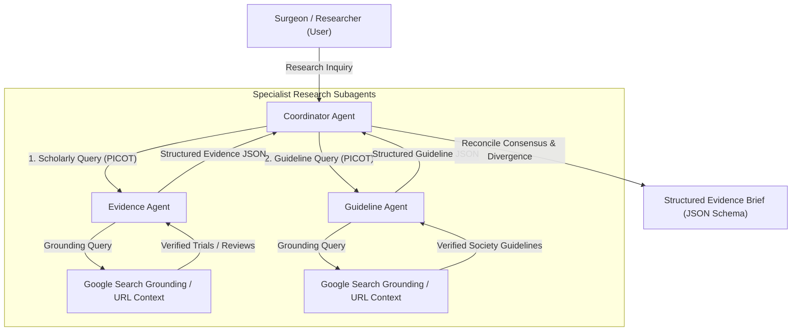
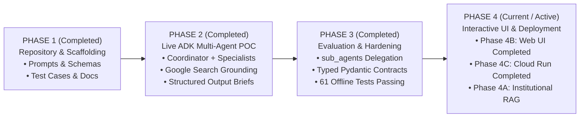

# Architecture & System Design

## Overview

The **Surgical AI Agents** system is designed to demonstrate multi-agent orchestration for evidence-based surgical research. The architecture transforms complex clinical research questions into structured, verified evidence briefs through task decomposition, specialized subagents, real-time web grounding, and schema-constrained generation.

---

## Product Boundaries & Operational Surfaces

The system strictly differentiates four operational surfaces to prevent architectural conflation:

1. **INTERACTIVE WEB UI**:
   - **Environment**: Local Web (`app/` FastAPI + Streamlit)
   - **Modality**: Multimodal Vision & Multi-Agent Consensus Studio
   - **Topology**: Full-featured interactive dashboard with tabs for Operative Vision Studio, 2-Subagent Consensus Studio, PICOT Query Decomposer, Specialist Deep-Dive, and Zero-Token Offline Simulation Mode.
   - **Role**: Primary hands-on interactive interface for attendees and facilitators, supporting both live Vertex AI and 0-token offline simulation across all 16 benchmark clinical cases.

2. **PRIMARY WORKSHOP SYSTEM (AGENT STUDIO)**:
   - **Environment**: Google Cloud Agent Studio (Agent Designer Canvas)
   - **Modality**: 100% Text-Based Multi-Agent Research Workflow
   - **Topology**: Root Coordinator + 2 Local Subagents (`evidence-specialist`, `guideline-specialist`)
   - **Role**: Visual workshop demonstration platform for interactive canvas inspection, subagent routing, and live preview traces.

3. **SUPPLEMENTAL VISION MINI-DEMO**:
   - **Environment**: Standalone Script (`multimodal-demo/`) or Agent Studio Chat / Freeform
   - **Modality**: Multimodal Vision-Language Understanding (`gemini-3.8-flash`)
   - **Role**: Supplemental 5-minute showcase illustrating operative anatomical landmark observation (Critical View of Safety) and computer vision research tasks.
   - **Boundary**: Kept strictly separated from the text-based research canvas; zero patient identification (100% synthetic vector schematics).

4. **DEVELOPER REFERENCE IMPLEMENTATION**:
   - **Environment**: Google Agent Development Kit (ADK `2.11.0` / `google-genai 2.28.0` on `gemini-3.8-flash`)
   - **Modality**: Code-based Python implementation with strict Pydantic / Draft-07 JSON Schema validation
   - **Role**: Programmatic baseline for offline unit testing, 6-dimension evaluation suites, CI/CD regression tests, terminal runners (`adk.run`), and developer customization.

---

## Architectural Components

### 1. Coordinator Agent
The orchestrator and synthesizer. It:
- Ingests the initial surgical research inquiry.
- Performs epidemiological normalization using the **PICOT** framework (Population, Intervention/Exposure, Comparator, Outcomes, Time range).
- Decomposes the research topic into two distinct query streams: scholarly clinical trials and authoritative surgical guidelines.
- Delegates sub-queries to specialist agents.
- Performs cross-agent synthesis, explicitly delineating consensus, conflicting findings, clinical uncertainties, and methodological limitations.
- Enforces strict clinical safety guardrails (refusing patient-specific guidance).
- Emits the final output adhering to `agents/coordinator/output-schema.json`.

### 2. Evidence Agent
The academic literature specialist. It:
- Evaluates peer-reviewed literature following the clinical evidence hierarchy (Systematic Reviews/Meta-analyses > Multicenter RCTs > Comparative Observational Studies).
- Extracts sample sizes, evaluated endpoints, effect estimates, and study limitations.
- Flags conflicting trial outcomes (e.g., European vs. American trials).
- Signals an explicit `not_found: true` state when reliable literature is absent.
- Emits structured output conforming to `agents/evidence/output-schema.json`.

### 3. Guideline Agent
The institutional policy and practice parameters specialist. It:
- Searches and catalogs official clinical practice guidelines, consensus statements, and practice advisories from recognized bodies (e.g., ASCRS, ERAS Society, SAGES, EAES, ESCP, NICE, WHO).
- Distinguishes formal guidelines from narrative reviews or expert editorials.
- Extracts formal recommendation grades, levels of evidence, and publication/update years.
- Identifies divergences between international societies.
- Reports an explicit `not_found: true` state if no formal society guideline exists.
- Emits structured output conforming to `agents/guideline/output-schema.json`.

### 4. Google Search Grounding
- Provides real-time retrieval capabilities to access verified scientific publications, clinical trial registries, and society guideline portals.
- Anchors agent responses in verifiable facts, preventing hallucination of non-existent trials or fabricated citations.

### 5. URL Context
- Inspects and verifies the full text or metadata of retrieved source URLs.
- Enables extraction of study endpoints, methodological details, and recommendation grades directly from original publisher or society web pages.

### 6. Structured Output Generation
- Enforces rigid JSON Schema validation across all agent boundaries.
- Replaces unstructured prose with structured objects (sources, agreements, disagreements, uncertainties, limitations).
- Ensures deterministic downstream consumption for web dashboards, educational slides, or automated evaluation pipelines.

---

## Phased Evolutionary Roadmap

### PHASE 1: Repository Scaffolding (Completed)
- **Scope**: Production instructions, JSON schemas, 8 demo questions, 8 failure modes, and test case catalog.
- **Status**: **VERIFIED & COMPLETED**.

### PHASE 2: Live ADK Multi-Agent POC (Completed)
- **Scope**: Live Python implementation using official `google-adk 2.11.0` and `google-genai 2.28.0`.
- **Tools**: Google Search Grounding (`google.adk.tools.google_search`) and URL Context (`url_context`).
- **Status**: **VERIFIED & COMPLETED**.

### PHASE 3: Evaluation & Hardening (Completed)
- **Scope**:
  - Modernized single-turn specialist delegation (`sub_agents=[evidence_agent, guideline_agent]`).
  - Explicit typed input contracts (`EvidenceQueryInput`, `GuidelineQueryInput`).
  - Native ADK evaluation framework (`AgentEvaluator`, `EvalSet`, `EvalConfig`) across 6 evaluation dimensions.
  - Distinguishing infrastructure failure (network/quota/timeout) from agent behavior failure.
  - Hardened schema conformance, timeout protection, and zero-PHI safety boundaries.
- **Status**: **VERIFIED & COMPLETED**.

### PHASE 4: Interactive UI, Deployment & Institutional RAG (Active)
- **Phase 4A: Institutional RAG (Future)**: Integration with Vertex AI Search for private hospital clinical pathways and local antibiograms (*Design phase*).
- **Phase 4B: Interactive Workshop UI (Completed)**: Lightweight FastAPI + Streamlit web runner in [`app/`](../app/) with multimodal vision studio, 2-subagent consensus pipeline, and 0-token offline simulation (*Status: Verified & Operational, 61 passing tests*).
- **Phase 4C: Cloud Deployment (Completed)**: Cloud Run containerization and Buildpacks/Dockerfile deployment guide in [`workshop/cloud-deployment.md`](../workshop/cloud-deployment.md) (*Status: Documented & Tested*).

